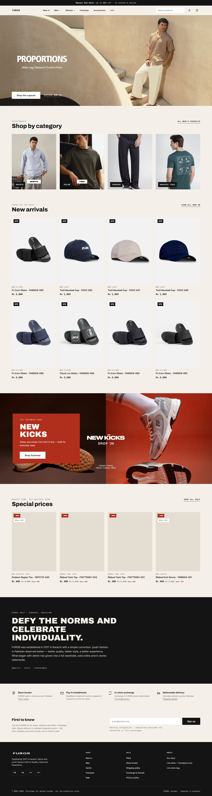
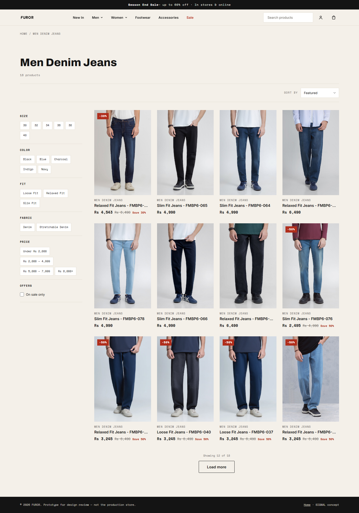

# FUROR — Premium Redesign Concept

An art-directed concept redesign for [FUROR](https://furorjeans.com/), a Karachi denim label (est. 2017): a complete, working static storefront prototype with zero frameworks, zero build steps, and zero dependencies.

**Live prototype:** [furor-jeans-redesign.vercel.app](https://furor-jeans-redesign.vercel.app)

**This is a design concept, not the live store.** It is hosted as a standalone prototype on Vercel and is not affiliated with the production site's Shopify setup.



## The direction — SIGNAL

A utility-editorial system: warm paper, near-black ink, and a single signal red used sparingly. Campaign images carry the emotion; type stays precise, labels stay monospaced, and product information reads like a spec sheet.

| Token | Value | Role |
|---|---|---|
| Paper | `#F4F0E9` | Background |
| Ink | `#141414` | Text and surfaces |
| Signal | `#E04129` | Graphics only (3.7:1) |
| Signal Deep | `#B02E1C` | Accent text (5.7:1) |
| Muted | `#6B675F` | Secondary text (4.8:1) |

**Type:** Archivo Black for display, Inter for UI, Space Mono for micro-labels.

## Pages

| Page | Entry | Highlights |
|---|---|---|
| Home | `site/index.html` | Campaign hero (desktop image-as-headline, mobile live type), new arrivals, special prices, editorial, story, footer |
| Collection | `site/collection.html` | Facets (size, color, fit, fabric, price, sale), sorting, scoped views (`new`, `sale`, `proportions`), URL-synced state, mobile filter sheet |
| Product | `site/product.html` | Gallery, per-variant sold-out states, add-to-bag validation, spec accordions, related rail, Product JSON-LD |
| Search | `site/search.html` | Live results, empty state with handoff to the live store's search |



## Data — real, not invented

250 products come from the store's public products feed, including titles, prices, variants, images, and spec lines. Nothing is fabricated:

- No invented prices, stock levels, policy terms, or integrations.
- Every control works or is explicitly labeled as pending integration.
- Checkout hands off to the live store instead of simulating a payment.

## QA

Rendered in headless Microsoft Edge at 1440 / 1280 / 1024 / 768 / 390 / 320 px:

- **17/17 suites pass, 0 console errors**
- No horizontal overflow, one visible `h1` per page, alt text on every image, no broken assets or dead links
- Per-page checks: facets and cards, sold-out variant chips, related products, empty search state, hero variant per breakpoint

Evidence lives in `_audit/shots/` (screenshots + `report.txt`). The suite is reproducible with `_tools/qa.mjs` (Node + puppeteer-core + installed Edge).

## Preview locally

Open `site/index.html` directly, or double-click `PREVIEW.cmd`. The prototype is entirely file:// safe — no server required.

## Deploy

Static site, no build step:

```
vercel deploy site --prod
```

## Project docs

- `_audit/PHASE-0-AUDIT.md` — evidence-based audit of the live site
- `_design/PHASE-1-ART-DIRECTION.md` — direction, type, color, layout system
- `_design/PHASE-2-8-NOTES.md` — build decisions through launch prep
- `_design/launch/` — sitemap and robots.txt drafts

## Structure

```
site/           the prototype (HTML, CSS, JS, assets, 250-product data)
_design/        art direction, launch notes, Instagram carousel
_audit/         phase-0 evidence, raw data, QA screenshots
_tools/         QA + capture scripts (local Node/gh binaries are gitignored)
```

## Scope

Built as a static front-end concept and hosted as a standalone Vercel deployment. Shopify integration points — checkout, BaadMay, restock notifications, newsletter — are labeled as pending, never simulated. Product imagery and data belong to FUROR; this repository documents a design concept only.
